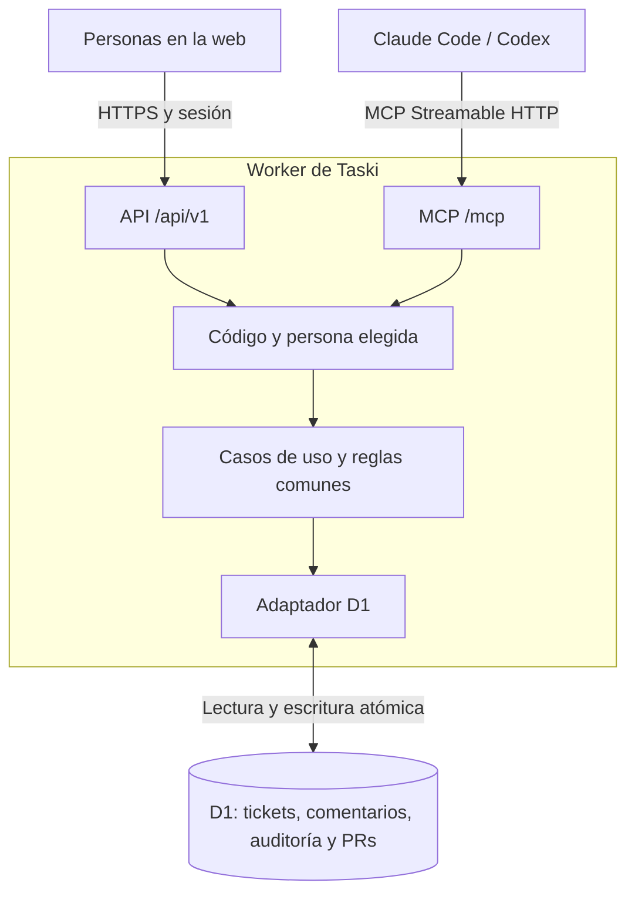

# Arquitectura y dataflow propuestos

TypeScript para servidor y primera web. Un Worker atiende HTTP/MCP; D1 mantiene tickets y actividad. El primer frontend se plantea en React, con contrato independiente para poder sustituirlo o añadir SwiftUI después.

## Una operación de creación

1. Web o agente envía los datos del ticket y una clave de idempotencia.
2. El Worker valida el acceso y construye el contexto del actor declarado.
3. Un caso de uso común valida campos y reglas.
4. El adaptador guarda ticket y evento de auditoría atómicamente en D1.
5. La respuesta devuelve código, URL y versión confirmados.
6. Los demás clientes ven el cambio al consultar de nuevo.

La versión esperada evita sobrescribir una edición concurrente. Las claves de idempotencia permiten reintentar sin duplicar tickets. La hora y la actividad se generan en el servidor.

## Durable Objects

La propuesta inicial no necesita Durable Objects. El manejador MCP remoto puede atender peticiones sin estado de sesión; los tickets persisten en D1. Un coordinador para cambios en vivo se evaluaría después si se incorporan conexiones WebSocket. La primera UI vuelve a consultar al guardar y recuperar foco, con consultas periódicas moderadas cuando esté visible.

Esto describe el diseño elegido para Taski, no una limitación del protocolo. Cloudflare documenta el [MCP sin estado](https://developers.cloudflare.com/agents/model-context-protocol/guides/remote-mcp-server/) y [D1 consultado desde Workers](https://developers.cloudflare.com/d1/).

## Fronteras de reutilización

Dominio y casos de uso independientes de React, MCP y D1. Los adaptadores HTTP/MCP llaman al mismo núcleo. Un adaptador de almacenamiento implementa la persistencia y la UI consume la API. Miembros, áreas, textos, logo, colores y dominio pertenecen a configuración/presentación.

Otra instalación tendrá otro Worker, otra base y otra configuración. Otro almacenamiento o runtime requiere implementar su adaptador: no se ofrece todavía como una opción funcional.

## Q2: archivos y clientes adicionales

R2 guardará imágenes/audio; D1 guardará referencias, texto y relaciones de notas/tareas. La app Swift y las sticky notes consumirán la misma API que la web. El bucket no sustituye la base ni la sincronización. Ver [Q2](q2.md).
