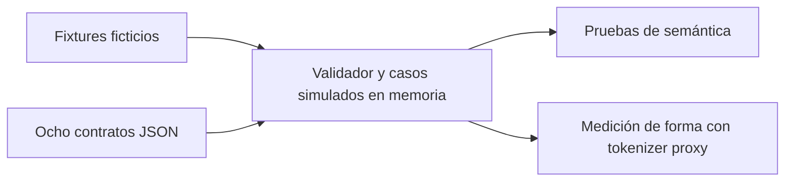

# Contrato candidato de ocho herramientas

Versión experimental B0, ligada al [issue #4](https://github.com/danirssx/taski/issues/4). Definiciones ejecutables en [catalog.json](../../experiments/b0/catalog.json), comportamiento local en [spike.py](../../experiments/b0/spike.py). No es un endpoint MCP disponible. Esquemas JSON sin dependencias del dominio en React; la futura implementación será TypeScript.

## Herramientas y defaults

| Herramienta | Entrada principal | Salida normal |
| --- | --- | --- |
| `get_project` | `knownVersion` opcional | Configuración completa si cambió; si coincide, solo versión, `notModified` y cursor de actividad. |
| `list_tickets` | Responsable/estado opcionales; `limit=20`, máximo 50; cursor | Resúmenes: key, title, status, assigneeId, highlighted, version. Cursor y campos omitidos explícitos. |
| `get_ticket` | key; `view=work`; `commentsLimit=5`, máximo 50 | Ticket con descripción completa y comentarios recientes en una operación. `summary` omite contexto; `full` conserva todos los campos. Comentarios antiguos paginados. |
| `create_ticket` | título y clave idempotente; descripción/responsable/área/tipo opcionales | Crear y asignar juntos; recibo con key, URL, versión y nombres de campos afectados. |
| `update_ticket` | key, expectedVersion, idempotencyKey; changes, patch y/o comentario | Cambios + avance atómicos; recibo pequeño. Puede combinar PR y estado sin usar otra herramienta. |
| `add_comment` | key, versión, clave idempotente y texto | Recibo y commentId. Usar la operación compuesta si también cambia el ticket. |
| `list_activity` | cursor opcional; `limit=20`, máximo 50 | Eventos concretos, cursor siguiente y hasMore. |
| `link_pull_request` | key, versión, clave idempotente y URL HTTPS | Guarda referencia manual; no consulta GitHub. |

En el spike `work` y `full` devuelven los mismos campos completos del ticket; ambos paginan comentarios, y `summary` sí reduce campos. Se conserva esta equivalencia explícita antes de diseñar proyecciones más finas. No se exige elegir docenas de campos para trabajar.

## Dos flujos en una operación cada uno

Entrada de lectura conjunta:

```json
{"key":"DEMO-001","view":"work","commentsLimit":5}
```

Devuelve `{ticket, comments, nextCommentsCursor, omitted}`. La descripción no se corta. Cuando hay comentarios antiguos, `nextCommentsCursor` permite leer páginas anteriores sin perder ninguno; una edición invalida el cursor de comentarios y exige repetir la lectura. `commentsLimit=0` y `summary` omiten comentarios explícitamente.

Entrada de actualización y avance:

```json
{"key":"DEMO-001","expectedVersion":1,"idempotencyKey":"work-001","changes":{"status":"in_review"},"comment":"Ready for review"}
```

Recibo esperado:

```json
{"key":"DEMO-001","url":"https://taski.example/t/DEMO-001","version":2,"changed":["status","commentAdded"],"commentId":"c-1"}
```

La actividad registra antes/después de `status` y el comentario añadido en un evento. Un `descriptionPatch` usa `{find, replace}`: exige una coincidencia única y versión vigente; registra el patch sin retransmitir ambas descripciones. Una sustitución completa de descripción sí transporta su contenido y se medirá como entrada larga. No confundir ese caso con un recibo ordinario.

## Estado, reintentos y errores

La clave idempotente se acota por miembro y herramienta: reenviar exactamente la misma petición devuelve el mismo recibo sin duplicar evento/comentario. Reutilizarla con otra petición o contexto produce `IDEMPOTENCY_CONFLICT`. Una versión obsoleta produce `VERSION_CONFLICT`; releer antes de decidir si se puede reintentar. Nunca hacer un reintento ciego cambiando la versión.

`REVIEW_REQUIRED` rechaza `done` desde agente sin delegación explícita; los cambios y el comentario fallan juntos. La delegación viene de un contexto de aplicación simulado, nunca de un campo libre de la herramienta. B3/B4 deberán validar y auditar el contexto real. La identidad del spike no autentica a nadie.

Otros errores: `NOT_FOUND`, `UNKNOWN_MEMBER`, `UNKNOWN_AREA`, `PATCH_CONFLICT`, `EMPTY_UPDATE`, `CONTENT_TOO_LONG`, `INVALID_CURSOR`, `CURSOR_EXPIRED`. Las entradas inválidas fallan la validación del esquema antes de escribir. B5/B6 traducirán estas condiciones al formato de errores HTTP/MCP y concretarán sus esquemas de salida; eso no está implementado aquí.

## Reutilizar y recuperar contexto

1. Obtener `get_project`; guardar configVersion y activityCursor en el contexto del cliente.
2. En la siguiente consulta de configuración, enviar knownVersion. Solo se omiten miembros/áreas si coincide; un cambio devuelve la configuración completa.
3. Consultar actividad desde el cursor, procesar todas las páginas y avanzar solo después de aplicarlas. Los eventos incluyen ticket, versión, actor declarado y cambios concretos; una descripción completa sigue disponible por key.
4. Cursor de actividad de otro epoch/futuro/inválido: `INVALID_CURSOR`. Fuera de retención: `CURSOR_EXPIRED`. Los cursores son opacos para el cliente; no derivarlos de fechas.
5. Para resincronizar: obtener configuración y guardar el cursor inicial, paginar todos los resúmenes, recuperar contenido completo requerido y consumir eventos desde ese cursor. Las lecturas posteriores pueden solaparse con eventos: aplicar por versión para no retroceder ni duplicar comentarios.
6. Las páginas de lista del spike se invalidan si cambia la revisión o los filtros; reiniciar la lista. Si caduca también el cursor inicial durante la recuperación, reiniciar la resincronización. La retención y el mecanismo de snapshot durables se concretarán en B3/B5.

El epoch del spike es fijo para reproducir fixtures; no es una garantía entre reinicios. La implementación persistente debe guardar el epoch/posición y emitir uno nuevo al restaurar o sustituir una base incompatible.

## Dataflow del experimento y de producción



El futuro flujo será cliente IA → MCP del Worker → mismo núcleo que HTTP → transacción D1 → recibo. Ni D1, ni transporte MCP, ni tiempos de red son ejercitados por el flujo anterior. Ver [arquitectura](../architecture.md).
