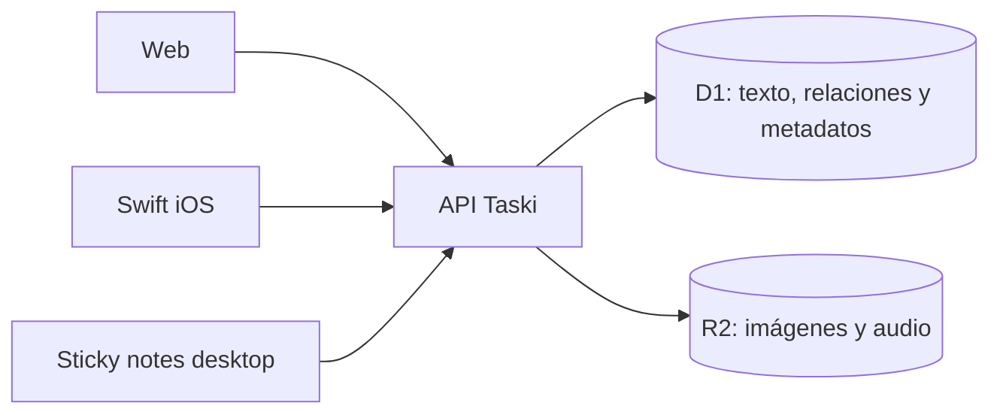

# Q2 · Segunda fase

Q2 es una etiqueta de fase posterior a v0.1; no fija un trimestre/año ni una fecha de entrega. Estas ideas no forman parte del desarrollo actual y se estimarán cuando se concreten sus contratos.

## Imágenes

Adjuntar imágenes a tareas, feedback y conversación desde teléfono o computadora. El archivo vive en Cloudflare R2; su referencia, autor, tamaño, tipo y relación con el ticket viven en D1. Definir límites, formatos, miniaturas, autorización, reintentos y retirada al implementar el bloque.

## Notas de voz

Grabar, escuchar, descartar y enviar audio en feedback/tareas. R2 guarda el binario; D1, duración y relación. Web y Swift deben poder reproducirlo. Verificar permisos y formatos en los dispositivos objetivo. La transcripción automática se evalúa aparte.

## SwiftUI

App de gestión para iOS consumiendo la API existente, con prioridad en aportar feedback y consultar conversación/adjuntos. Reutiliza servidor, identificadores, reglas y almacenamiento.

## Sticky notes de escritorio

Experiencia inspirada en Stickies de Apple: notas pequeñas en la laptop, independientes o vinculadas a tareas, sincronizadas con la web. Evaluar un cliente de escritorio y su tecnología después de un prototipo.

- Texto y relaciones en D1; imágenes/audio en R2.
- Misma API de la web y móvil.
- Posición/tamaño de ventana como preferencias del dispositivo si procede.
- Definir sincronización, conflictos y modo sin conexión antes de implementarlos.
- Evaluar coordinación en vivo cuando se necesite; no obliga a incorporar Durable Objects ahora.

## Dataflow

R2 almacena archivos; la API y D1 mantienen la relación y versión del contenido. La configuración del bucket corresponde a cada instalación cuando llegue esta fase.
